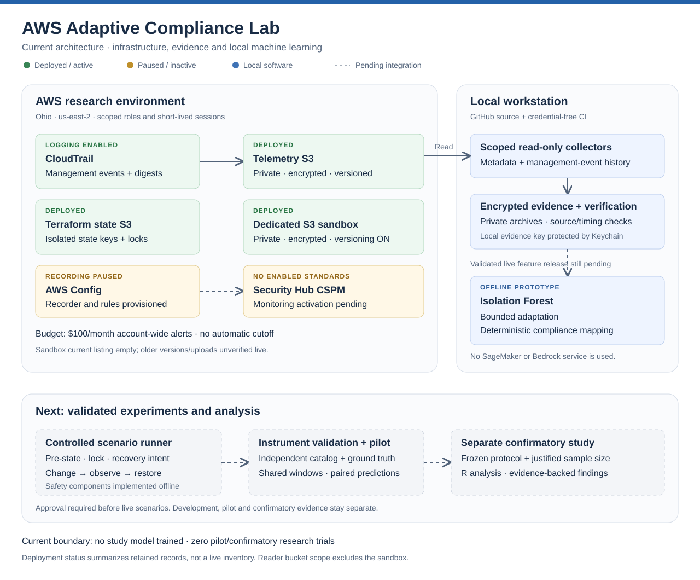

# AWS Adaptive Compliance Lab

**Research software for comparing native AWS compliance monitoring with an adaptive anomaly-detection approach.**

AWS Adaptive Compliance Lab combines reproducible Terraform infrastructure, encrypted evidence collection, an Isolation Forest prototype, bounded adaptation, and deterministic technical compliance mapping. Its purpose is to investigate when these approaches detect configuration problems, where they disagree, and how trustworthy their evidence is.

**Academic context.** This repository supports the dissertation study **“AI-Driven Adaptive Security Compliance Monitoring for AWS Cloud-Native Systems”** by **Martin M. Morales**, conducted as part of the **Doctor of Science in Computer Science** program at **Aspen University**. The project provides the software and experimental infrastructure for comparing adaptive, AI-driven compliance monitoring with native AWS monitoring.

**Status: active development.** Infrastructure is partially deployed, and the ML pipeline works with synthetic engineering fixtures. No study model has been trained and no pilot or confirmatory research results exist. This is research software, not a validated compliance product or a certification tool.

[Get started](#try-it-without-an-aws-account) · [Documentation](docs/README.md) · [Research pipeline](research/README.md) · [Infrastructure](infra/README.md) · [Roadmap](docs/implementation-plan.md) · [Progress and remaining work](docs/project-status.md)

## What the project does

- **Reproduces infrastructure:** separate Terraform roots for protected state, bounded access, monitoring, evidence-reader access and a dedicated sandbox.
- **Retains evidence:** scoped collectors, encrypted local archives, receipt verification and explicit timing/freshness boundaries.
- **Implements actual ML:** scikit-learn Isolation Forest, score-before-adapt safeguards, held-out protections and bounded updates with rollback checks.
- **Separates anomalies from compliance:** unusual behavior receives an anomaly score; fixed technical predicates and evidence quality govern the mapped outcome. An anomaly score is not a probability of noncompliance.
- **Protects evaluation:** expected answers remain separate from model inputs and are joined only after paired predictions are saved.
- **Builds toward safe experiments:** offline protection/emptiness checks, a recovery decision planner and a persistent local execution lock. These components are not yet a live scenario runner.

## Architecture

Solid arrows show implemented paths; dashed arrows show integration or activation still pending. This diagram summarizes retained deployment records, not a live account inventory.



[Open the full-size architecture diagram](docs/assets/architecture.svg)

The telemetry reader's bucket allowlist excludes the sandbox. A separate bounded sandbox observer role is now deployed and its short-lived role identity verified; one approved encrypted development pass has completed and its retained records passed local consistency checks. Neither CI nor the offline scenario components deploy infrastructure or run cloud experiments. The ML prototype runs locally; no SageMaker or Bedrock service is used.

## Current completion boundary

| Area | Implemented | Still required |
| --- | --- | --- |
| AWS foundation | Protected state, scoped roles, telemetry storage and dedicated sandbox | Reviewed plans for further activation or permissions |
| Monitoring | CloudTrail logging and service-reported delivery | Config/CSPM activation, attributable events and prospective instrument validation |
| Evidence | Encrypted collectors, native scheduling and offline verification | Verified trigger, freshness, completeness and paired live monitoring |
| Scenario execution | Offline pre-state checks, recovery planner, persistent lock, encrypted intent, bounded recovery reading, restoration candidates, a preview-first Keychain operator and a supervised observer-to-intent preparation command with encrypted intent readback | Verified live source/restoration, reviewed lock release, integrated driver and approved rehearsal |
| AI/ML | Isolation Forest, bounded adaptation, deterministic mapping and synthetic demonstrations | Valid study inputs, independent splits and retained study model |
| Catalog | Twelve draft S3 cases and separate expected answers | EC2, Lambda, EKS, VPC and IAM coverage; source validation and independent review |
| Analysis | Paired output and timing contracts | Locked R environment, power simulations and five-outcome inferential analysis |

A completed development capture verified three snapshots and their acquisition schedule. That is an instrument-development observation, not a research trial or a performance result. A separate approved sandbox observer pass retained complete empty listings for current objects, versions/deletion markers and unfinished uploads, with the expected protections. These sequential receipt-time checks do not establish atomic emptiness or research readiness. [Verification details](docs/sandbox-verification.md). The new [supervised preparation command](docs/supervised-preparation.md) connects observation to encrypted recovery intent; its first live run awaits separate review and approval. [See the detailed roadmap](docs/implementation-plan.md).

## Try it without an AWS account

The offline path requires no AWS credentials and creates no cloud resources. Use Python 3.13 for the locally tested runtime. The pinned requirements install both scientific packages and the SDK dependencies needed by the regression suite. OpenSSL 3 is needed for encryption tests; macOS-specific Keychain tests require their platform and are handled separately by the suite.

```sh
# Clone the source and create an isolated local environment.
git clone https://github.com/machine88/aws-adaptive-compliance-lab.git
cd aws-adaptive-compliance-lab
python3.13 -m venv .venv

# Install pinned dependencies without placing credentials in the repository.
.venv/bin/python -m pip install --only-binary=:all: -r requirements-ml.txt -r requirements-aws.txt
.venv/bin/python -m pip check

# Check documentation, catalog boundaries and offline behavior.
.venv/bin/python scripts/check_function_docs.py
.venv/bin/python scripts/audit_catalog.py
.venv/bin/python -m unittest discover -s tests -v
```

The catalog audit deliberately reports that the draft is not research-ready. Passing software tests does not remove those design limitations. Some process-control tests require a normal local process environment.

### Run the synthetic ML demonstration

```sh
# Use a new output path each time; existing runs are never overwritten.
mkdir -p evidence
.venv/bin/python scripts/controller_smoke.py --output evidence/first-synthetic-controller-run
```

The demonstration fits a real Isolation Forest, saves paired synthetic outputs, exercises bounded adaptation and performs a delayed expected-answer join. Its summary explicitly records `synthetic_only=true`, `aws_calls=0` and `research_trials=0`. The baseline adapter deliberately returns unknown. Artificial independence groups test wiring and do not validate the real catalog or demonstrate improved compliance detection.

Generated observations and fitted model artifacts stay under ignored `evidence/`. Do not upload them as source code.

## Working with AWS

The checked-in deployment configuration is bound to one research account, region and resource set. Cloning this repository does **not** make it ready to apply to another account. The GitHub project name differs from legacy deployed names containing `dissertation`; renaming the repository does not rename buckets, roles, tags, state keys or protocol identifiers.

Start with the [infrastructure guide](infra/README.md). Offline Terraform checks use version **1.15.0**, checked-in provider lockfiles, disabled backend initialization and mocked providers. They may download providers but do not deploy AWS resources. GitHub Actions validates source with no AWS credentials or deployment permissions.

Every live plan needs explicit review of identity, permissions, isolated state, costs, evidence scope and recovery. A code merge does not authorize an apply, monitoring activation, scenario change or capture. Source creation/activation defaults are not safe pause switches for resources already deployed with explicit active inputs.

The configured **$100 monthly budget is an alert**, not a cutoff or cost estimate. Receipt of alert emails has not been demonstrated. Existing CloudTrail logging continues independently of local credential expiry.

## Research integrity

- The final approved research proposal is the methodological source of truth; its traceability and unresolved decisions are [documented here](docs/proposal-traceability.md).
- Development, pilot and confirmatory evidence remain separate. Synthetic fixtures are never empirical study results.
- Missing or late evidence, unknown outcomes, failed fits and nondetections remain visible.
- Ground truth does not enter model features; held-out observations cannot train, calibrate or adapt the model.
- Baseline fusion, feature validity, independent catalog splits, protocol freeze, power analysis and external review remain open gates.

## Contributing and reuse

[Contribution guidance](CONTRIBUTING.md) explains offline checks, function documentation and research boundaries. Start with a small, testable change and describe its inputs, outputs, validation and limitations.

This public repository does not currently include a software license. Public visibility alone does not grant an open-source reuse license; a license decision remains pending. Never publish credentials, private keys, Terraform state/plans, raw account inventories, research captures or participant/reviewer details in an issue or pull request.
